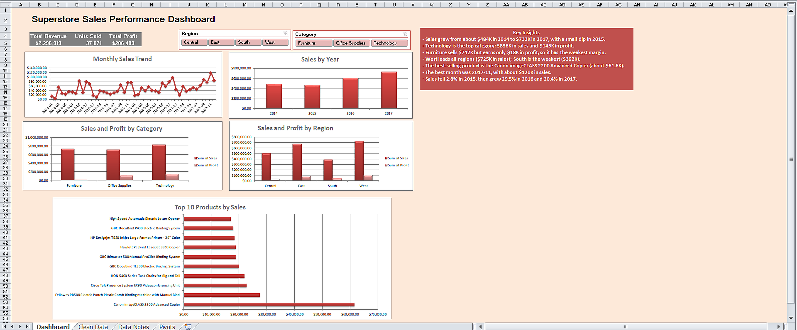
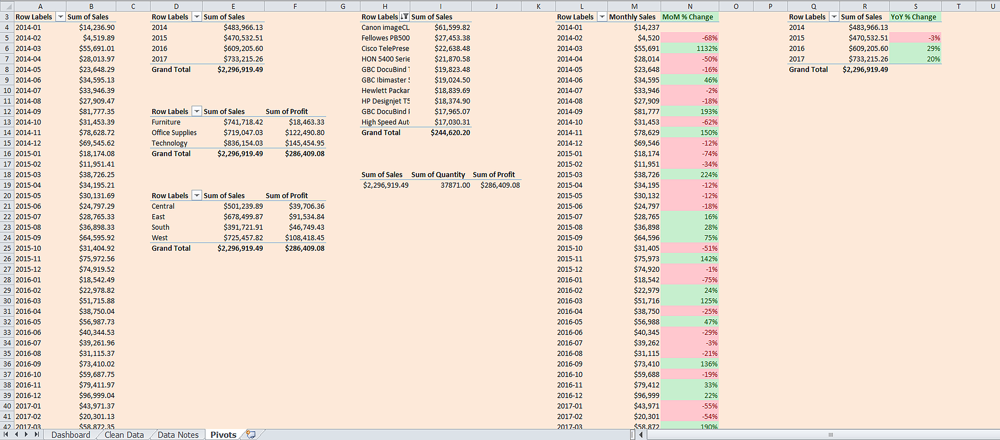

# Task 1: Sales Performance Dashboard Using Excel

Elevvo Internship, Data Analytics Track

An interactive Excel dashboard that summarizes the sales performance of a retail superstore (2014-2017). Built with Excel 2010 using formulas, pivot tables, charts and slicers.

## Dashboard Preview

## Pivot Tables

## Dataset

- **Source:** [Superstore Dataset (Kaggle)](https://www.kaggle.com/datasets/vivek468/superstore-dataset-final)
- **Size after cleaning:** 9,993 rows, 26 columns (including 5 added formula columns)
- **Period:** January 2014 to December 2017
- **Key fields:** Order Date, Ship Date, Region, Category, Sub-Category, Product Name, Sales, Quantity, Discount, Profit

## Tools

- Microsoft Excel 2010 (tables, formulas, pivot tables, pivot charts, slicers, conditional formatting)

## What I Did

### 1. Import and clean
- Imported the CSV and saved it as `.xlsx`.
- Converted the data into an Excel Table named `SuperstoreData`.
- Fixed Order Date and Ship Date to proper date format.
- Removed 1 empty row and 1 duplicate row.
- Checked every key column for missing values with `COUNTBLANK` (all 0 after cleaning).
- Formatted Sales and Profit as currency, Discount as a percentage, and froze the header row.
- Documented every step in a **Data Notes** sheet.

### 2. Formulas
Added these calculated columns to the table:

| Column | Formula | Purpose |
|---|---|---|
| Year | `=YEAR([@[Order Date]])` | Yearly grouping |
| Month | `=TEXT([@[Order Date]],"yyyy-mm")` | Monthly trend labels |
| Month Num | `=MONTH([@[Order Date]])` | Month number (1-12) |
| Shipping Days | `=[@[Ship Date]]-[@[Order Date]]` | Delivery time |
| Profit Margin | `=IFERROR([@Profit]/[@Sales],0)` | Profit divided by sales |

### 3. Pivot tables
- **KPI totals:** total revenue, units sold, total profit
- **Monthly trend:** sales per month
- **Yearly sales:** sales per year
- **Category:** sales and profit by product category
- **Region:** sales and profit by region
- **Top 10 products** by sales

### 4. Charts and dashboard
Five pivot charts (monthly trend, sales by year, category, region, Top 10 products), three KPI cards, and a Key Insights box, arranged on a single Dashboard sheet.

### 5. Bonus
- **Slicers:** Region and Category slicers connected to all pivot tables, so one click filters the whole dashboard.
- **MoM change:** month-over-month % change pivot, with red for decreases and green for increases.
- **YoY change:** year-over-year % change pivot, with the same color rules.

## Key Metrics

| Metric | Value |
|---|---|
| Total Revenue | $2,296,919 |
| Units Sold | 37,871 |
| Total Profit | $286,409 |

## Key Insights

1. **Growth:** Sales rose from about $484K in 2014 to $733K in 2017. After a small dip of 2.8% in 2015, they grew 29.5% in 2016 and 20.4% in 2017.
2. **Technology leads:** It is the top category, with $836K in sales and $145K in profit.
3. **Furniture has weak margins:** It sells $742K but earns only $18K in profit, about 2.5% margin, compared with roughly 17% for Technology and Office Supplies.
4. **Regional gap:** The West is the strongest region ($725K in sales) and the South is the weakest ($392K).
5. **Best seller:** The Canon imageCLASS 2200 Advanced Copier is the top product, with about $61.6K in sales.
6. **Seasonality:** Sales peak toward the end of each year, and November 2017 is the strongest month.

## Files

| File | Description |
|---|---|
| `Superstore_Sales_Dashboard.xlsx` | The full workbook (Dashboard, Clean Data, Data Notes, Pivots sheets) |
| `Dashboard.png` | Screenshot of the finished dashboard |
| `Pivots.png` | Screenshot of the pivot tables |
| `README.md` | This file |

## How to Use

1. Open `Superstore_Sales_Dashboard.xlsx` in Excel.
2. Go to the **Dashboard** sheet.
3. Click the **Region** or **Category** slicers to filter all charts and KPIs.
4. Click the clear-filter icon on a slicer to reset.

## Notes

- Excel 2010 has no distinct-count pivots, so "orders" are not shown as a KPI. Units sold uses the Quantity column.
- Pivot tables and charts update when you use **Data → Refresh All** after changing the source table.
