# Task 5: SQL-Based Analysis of Product Sales

Elevvo Internship, Data Analytics Track

SQL analysis of the Chinook digital music store database. I used JOINs and aggregations to answer three business questions (top-selling products, revenue per region, monthly performance), then added window functions as a bonus.

## Dataset and Tools

- **Dataset:** [Chinook Database (Kaggle)](https://www.kaggle.com/datasets/ranasabrii/chinook), a sample database for a digital media store
- **Database file:** `Chinook_Sqlite.sqlite` (11 tables, 412 invoices, 2,240 invoice lines, 3,503 tracks, 275 artists, 59 customers)
- **Period covered:** 2009-01-01 to 2013-12-22
- **Tool:** DB Browser for SQLite (SQLite)

## Database Structure

The queries combine these tables:

| Join | Meaning |
|---|---|
| `InvoiceLine.InvoiceId = Invoice.InvoiceId` | which sale an item belongs to |
| `InvoiceLine.TrackId = Track.TrackId` | which song was sold |
| `Track.AlbumId = Album.AlbumId` | which album the song is on |
| `Album.ArtistId = Artist.ArtistId` | which artist made the album |
| `Track.GenreId = Genre.GenreId` | which genre the song belongs to |

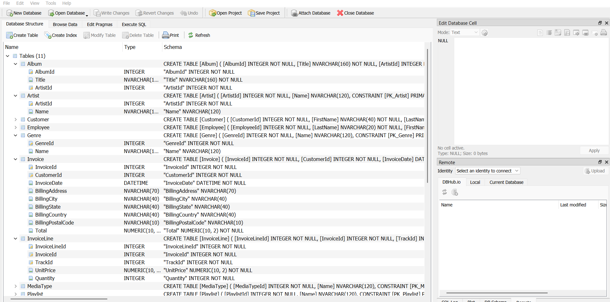
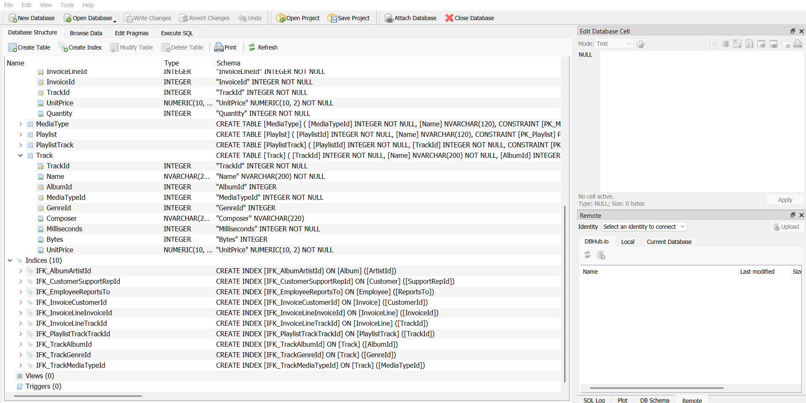

Row counts and date range of the data:

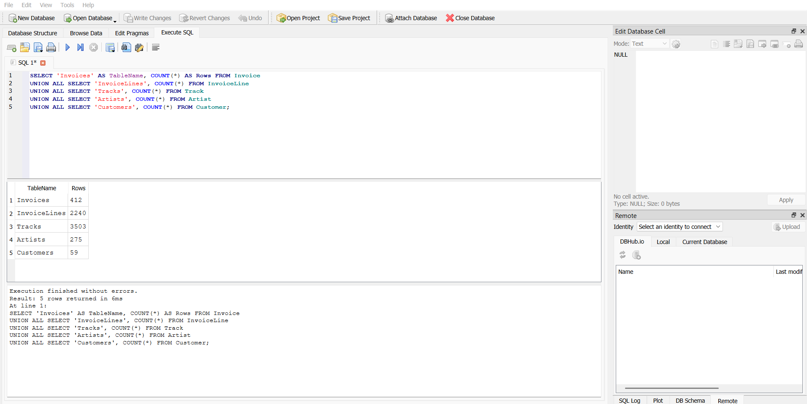
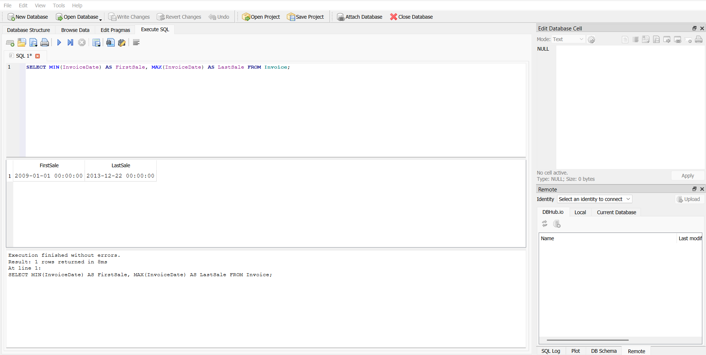

## Queries and Results

All queries are in [`Task5_Chinook_Analysis.sql`](Task5_Chinook_Analysis.sql).

### 1. Top-selling products

| Query | Question | Tables joined |
|---|---|---|
| Q1 | Top 10 best-selling tracks | InvoiceLine, Track, Album, Artist |
| Q2 | Top 10 artists by revenue | InvoiceLine, Track, Album, Artist |
| Q3 | Revenue by genre | InvoiceLine, Track, Genre |

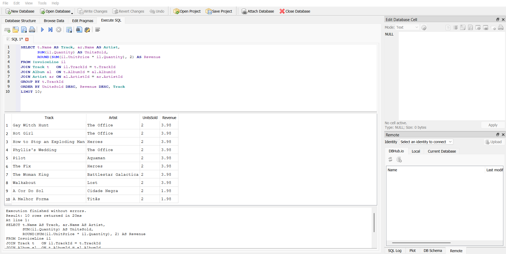
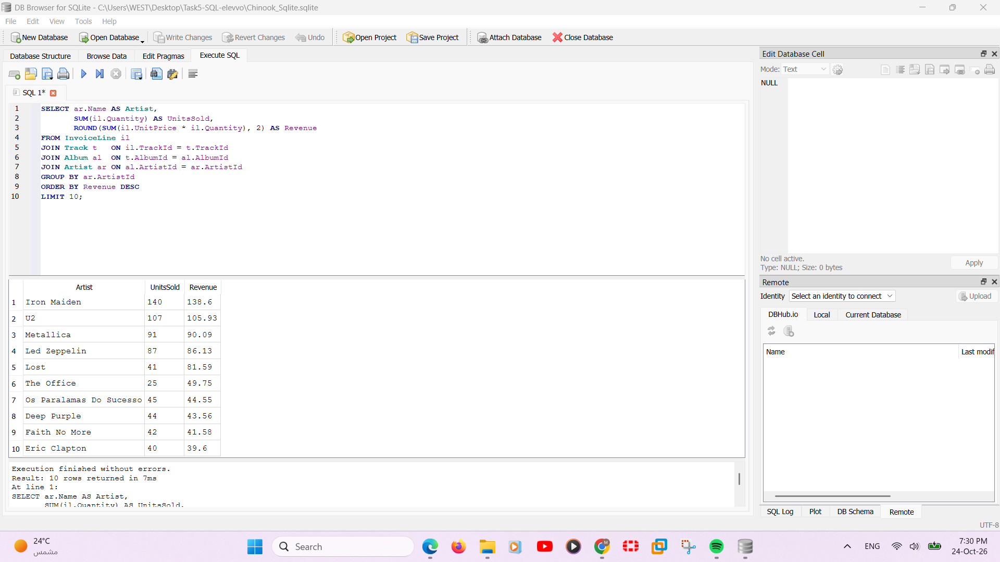
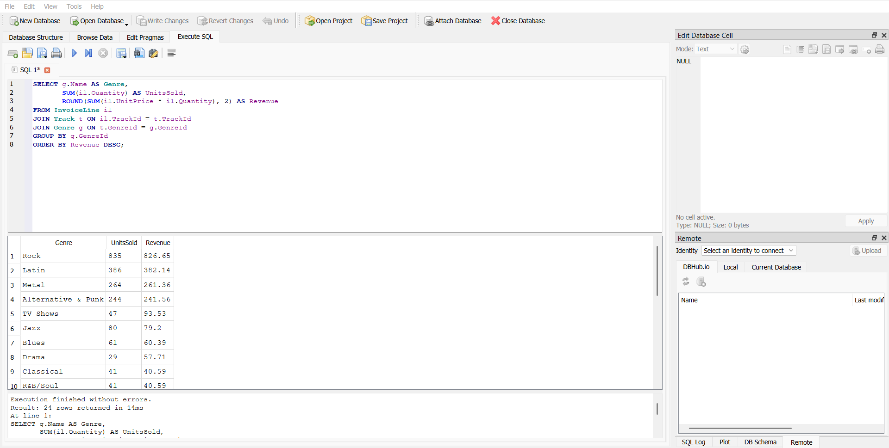

### 2. Revenue per region

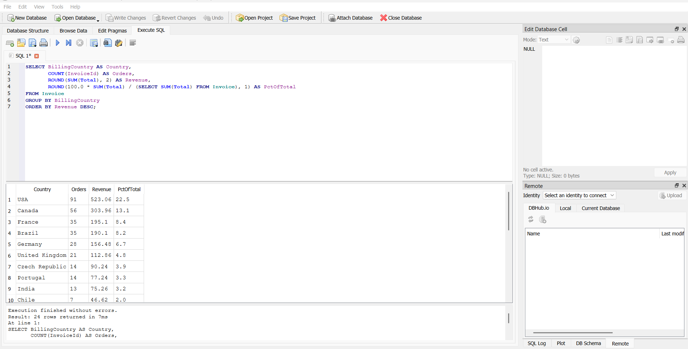

### 3. Monthly performance

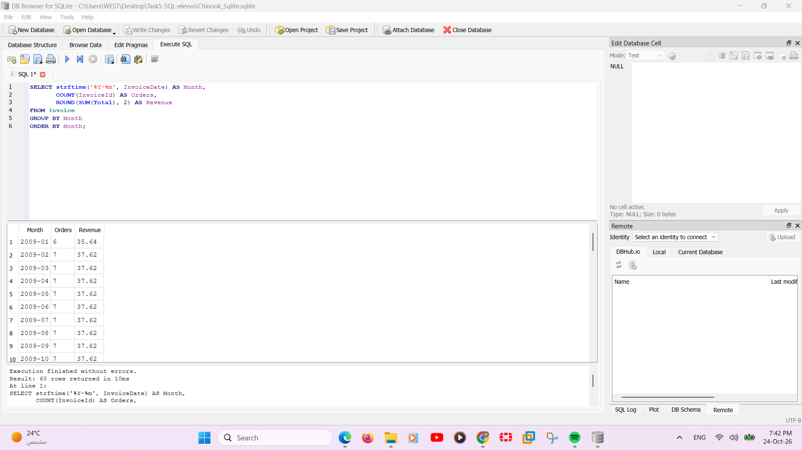
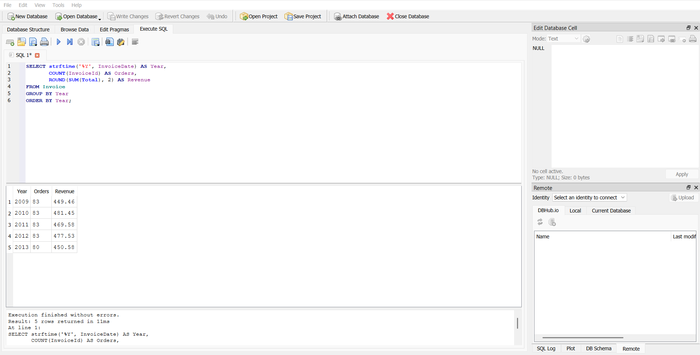
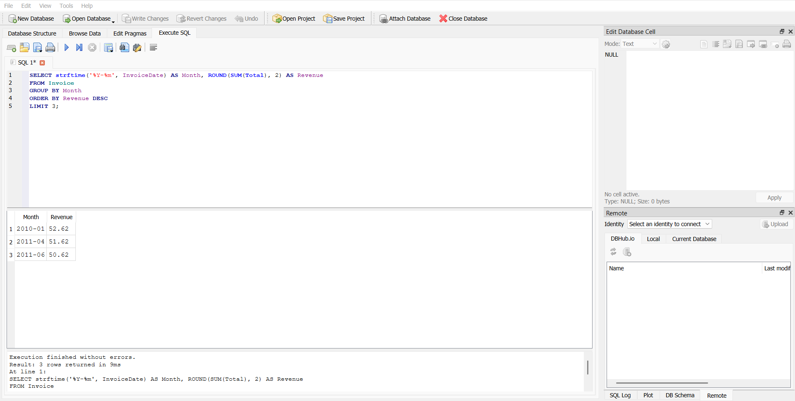
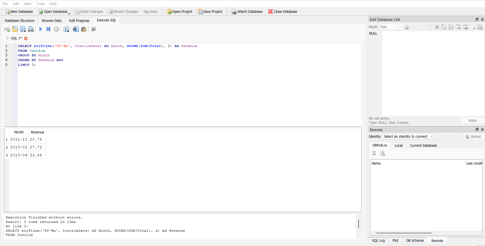

### 4. Bonus: window functions

| Query | Window function | What it shows |
|---|---|---|
| Bonus A | `RANK() OVER (ORDER BY ...)` | Artists ranked by revenue |
| Bonus B | `ROW_NUMBER() OVER (PARTITION BY ...)` | Top-selling artist in each country |
| Bonus C | `LAG() OVER (ORDER BY ...)` | Month-over-month % change in revenue |

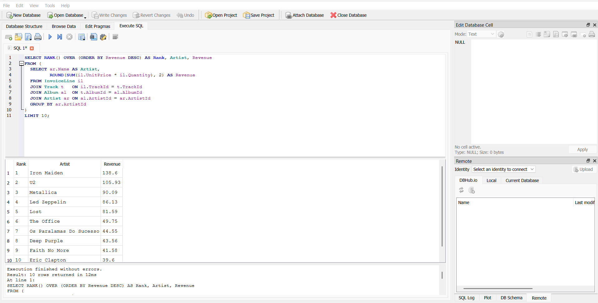
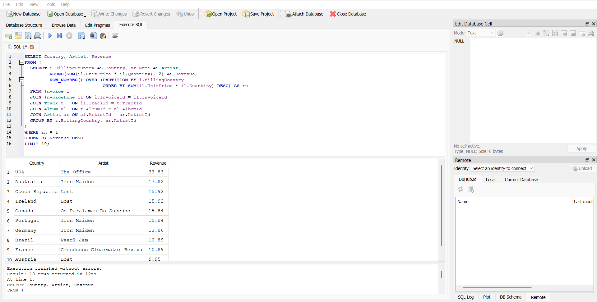
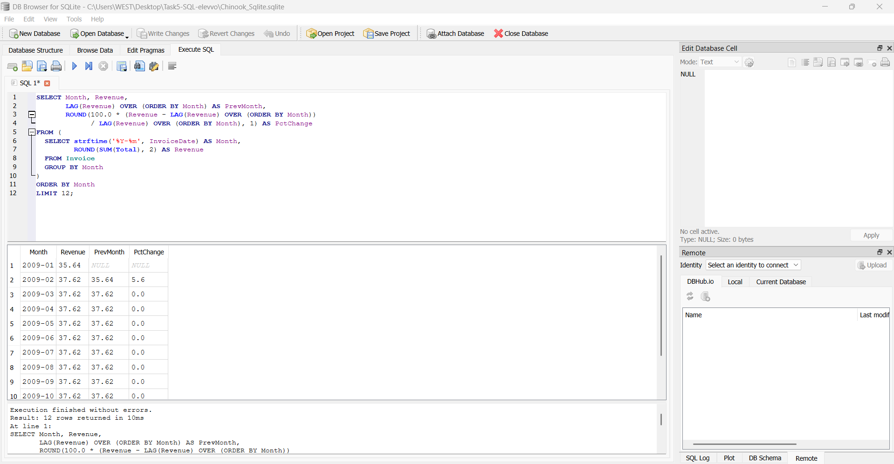

## Key Insights

1. **Rock dominates.** Rock earns $826.65 from 835 units, about 35.5% of total revenue. Latin ($382.14), Metal ($261.36) and Alternative & Punk ($241.56) follow.
2. **Iron Maiden is the top artist** with $138.60 from 140 units, followed by U2 ($105.93), Metallica ($90.09) and Led Zeppelin ($86.13).
3. **TV shows punch above their weight.** "Lost" ranks 5th among artists with only 41 units but $81.59, because TV episodes sell at $1.99 compared with $0.99 for songs.
4. **No single track dominates.** The top 10 tracks all sold exactly 2 units, so ranking artists and genres gives a clearer picture than ranking tracks.
5. **Revenue is concentrated in a few countries.** The USA earns $523.06 (22.5% of revenue), then Canada ($303.96, 13.1%), France ($195.10), Brazil ($190.10) and Germany ($156.48). These five countries make up about 59% of all revenue.
6. **Sales are steady over time.** Yearly revenue stays between $449 and $481 (2010 is the best year at $481.45). 2013 shows 80 orders because the data ends on December 22.
7. **Best and worst months.** The best months are 2010-01 ($52.62), 2011-04 ($51.62) and 2011-06 ($50.62). The weakest are 2011-11 ($23.76), 2013-02 ($27.72) and 2013-04 ($33.66).
8. **Local favourites differ by country.** The top artist in the USA is The Office ($33.83), in Australia, Portugal and Germany it is Iron Maiden, in Brazil it is Pearl Jam, and in France it is Creedence Clearwater Revival.

## Files

| File | Description |
|---|---|
| `Task5_Chinook_Analysis.sql` | All SQL queries (6 business queries + 3 bonus window-function queries) |
| `Chinook_Sqlite.sqlite` | The Chinook database used |
| `*.png` | Screenshots of the database structure and query results |
| `README.md` | This file |

## How to Run

1. Install [DB Browser for SQLite](https://sqlitebrowser.org).
2. Open `Chinook_Sqlite.sqlite` (set the file filter to "All files").
3. Go to **Execute SQL**, write your **Query** , and press **Ctrl+Enter**.

