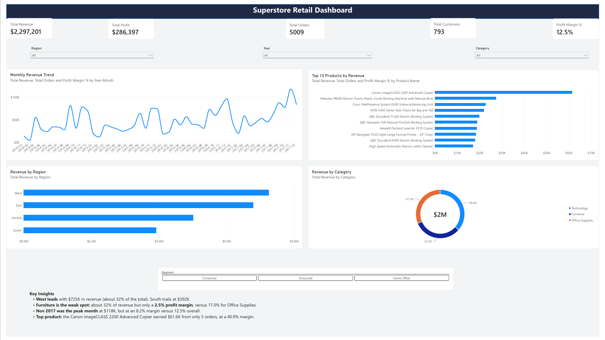

# Superstore Retail Dashboard (Power BI)

Interactive Power BI dashboard built for the **Elevvo Internship**, Data Analytics **Task 8: Power BI Dashboard for Retail Insights**.

## Dataset

[Superstore Dataset (Kaggle)](https://www.kaggle.com/datasets/vivek468/superstore-dataset-final): 9,994 order lines covering 2014-2017, with sales, profit, quantity, discount, region, category, segment and product details.

## Key metrics (full dataset)

| Metric | Value |
|---|---|
| Total Revenue | $2,297,201 |
| Total Profit | $286,397 |
| Profit Margin | 12.5% |
| Total Orders | 5,009 |
| Total Customers | 793 |

## What I built

**Data preparation (Power Query)**
- Set correct data types for dates, sales, profit, discount, quantity and postal code
- Checked for duplicate rows and missing values
- Renamed the query to `Sales`

**Data model**
- Created a `DateTable` with DAX (Date, Year, Month, Month Number, Year-Month)
- Marked it as the date table, sorted Month by Month Number, and related it to `Sales[Order Date]`

**DAX measures**
- Total Revenue, Total Profit, Profit Margin %
- Total Orders, Total Customers, Units Sold, Avg Order Value
- Revenue LY and Revenue YoY %

**Dashboard**
- KPI cards: revenue, profit, orders, customers, profit margin
- Monthly revenue trend (line chart)
- Top 10 products by revenue (bar chart with a Top N filter)
- Revenue by region (bar chart)
- Revenue by category (donut chart)
- Slicers: Region, Year, Category
- **Custom visual:** Chiclet Slicer for customer Segment
- **Tooltips** showing total orders and profit margin on hover

## Key insights

- **West leads** with $725K in revenue (about 32% of the total). South trails at $392K.
- **Furniture is the weak spot:** about 32% of revenue but only a 2.5% profit margin, versus 17.0% for Office Supplies.
- **November 2017 was the peak month** at $118K in revenue, but at an 8.2% margin versus 12.5% overall.
- **Top product:** the Canon imageCLASS 2200 Advanced Copier earned $61.6K from only 5 orders, at a 40.9% margin.
- **Segments:** Consumer $1.16M, Corporate $706K, Home Office $430K.

## Files

| File | Description |
|---|---|
| `Superstore_Dashboard.pbix` | Power BI report (open with Power BI Desktop) |
| `Superstore_Dashboard.pdf` | Exported dashboard |
| `dashboard.png` | Dashboard screenshot |
| `Superstore.csv` | Source data |

## How to use

1. Download `Superstore_Dashboard.pbix`
2. Open it in Power BI Desktop (Windows)
3. If prompted, point the data source to `Superstore.csv`
4. Use the slicers (Region, Year, Category, Segment) to filter, and hover over charts for tooltips

## Tools

Power BI Desktop, Power Query, DAX

## Author

[Malak Meaity](https://linkedin.com/in/malakmeaity)
